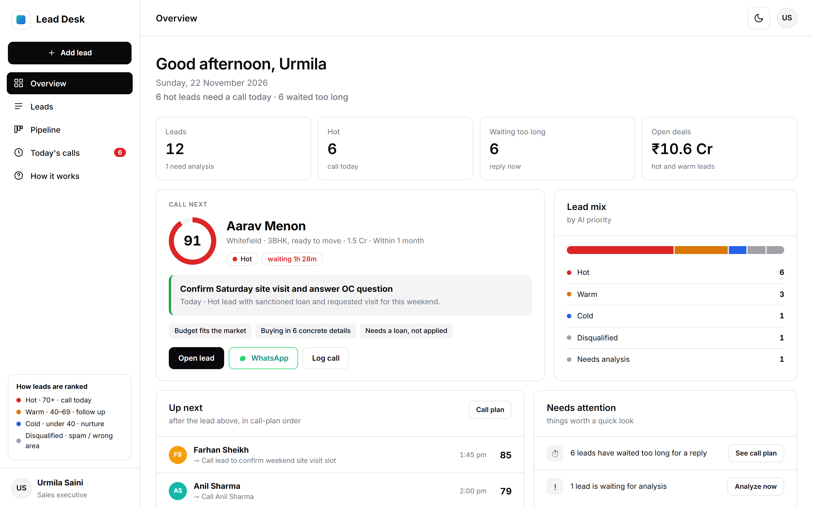
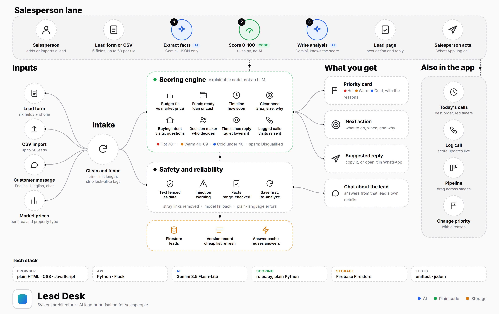

<h1 align="center">Lead Desk</h1>

A salesperson opens their inbox to a hundred new leads and has to decide who to call first. Lead Desk reads each inquiry, scores it, explains the score, says what the customer wants and what to do next, and drafts a WhatsApp reply. You can then chat with it about any one lead.



## What I built

| Feature | What it does |
|---|---|
| **Add leads** | A form with the six fields from the brief (plus an optional phone number), or a CSV import of up to 50 leads. There's a [sample file](static/sample_leads.csv). |
| **AI analysis** | Summary, customer intent, key requirements, objections (each with a way to handle it), recommended next action and a suggested reply. |
| **Priority** | A 0-100 score, grouped into Hot / Warm / Cold / Disqualified, with the main reasons on every card. |
| **Lead page** | The next action sits across the top. The left side is for understanding the customer, the right side is the reply and the score breakdown. |
| **Chat** | A button in the corner of the lead page. It only knows about that lead, so "what should I emphasize on the call?" or "make my reply more assertive" gets a specific answer. |

### The feature I added

I thought about what happens before, during and after the screen.

| Feature | What it does |
|---|---|
| **Today's calls**<br>*before the call* | Orders Hot and Warm leads by score and by how long they've been waiting, and keeps any time the customer asked for ("call after 7 PM"). Leads nobody has replied to get a red timer. |
| **Talking points, chat, WhatsApp**<br>*during the call* | Points to lead with, a chat that knows the lead, and a WhatsApp button that opens a chat with the reply already typed. |
| **Log call**<br>*after the call* | Pick an outcome and type rough notes. The AI picks out anything new ("loan approved", "wife also decides"), the score updates (say 72 to 81), and you get a follow-up message and a new next action. |
| **Pipeline** | A board from New to Booked or Lost that you drag leads across. Logging a call moves the stage for you. |
| **Change priority** | For when you disagree with the AI. It asks for a reason and keeps the AI's original tag visible. |

## Architecture



## AI model and how it's called

Gemini through the `google-genai` SDK, on the free tier. One model does everything: `gemini-3.5-flash-lite`, with `gemini-3.5-flash` as a backup if the daily quota runs out.

| Step | Temperature | Job |
|---|---|---|
| Extract facts | 0 | Read the message and return facts as JSON. It never scores. |
| Write analysis | 0.3 | Summary, intent, objections, next action and reply, knowing the score. |
| Chat | 0.4 | Answer about one lead, using its details, analysis and call log. |
| Log call | 0.3 | Pull new facts out of call notes and draft the follow-up. |

- Each step has its own system prompt and asks for JSON. Replies are checked against a whitelist before they're saved.
- Customer text sits inside tagged data blocks, and the prompts say never to follow instructions found in it.
- 20 second timeout, short retries, and identical input reuses a cached answer. All calls go through `call_json()` in [leaddesk/ai.py](leaddesk/ai.py).

## How to run it locally

You need Python 3.11+, a free Gemini key from https://aistudio.google.com/apikey, and a Firebase project.

1. Create a Firebase project with a Firestore database, then add its service-account JSON in the `.env` file (see `.env.example`).
2. Make a virtual environment, install and start:

```bash
python -m venv .venv
source .venv/bin/activate        # Windows: .venv\Scripts\activate
pip install -r requirements.txt
cp .env.example .env             # Windows: copy .env.example .env, then fill in GEMINI_API_KEY and the Firebase JSON
python app.py                    # http://localhost:5000
```

Tests:

```bash
python tests/run_all.py                # Python and browser tests, fake AI, no key needed
python tests/live_check.py             # optional: one real run through the AI, about 7 calls
python tests/load/load_test.py         # optional: 10, 25 and 50 simulated users
python tests/load/firestore_scale.py   # optional: the real database as leads pile up (throwaway collections)
```

## Key technical decisions

- **The AI finds facts, code does the scoring.** A model asked for a 0-100 score gives different numbers each run and can't explain them. Rules give the same score every time, with a reason for every point.
- **Not mentioned isn't "no", and objections don't hurt a lead.** No loan mentioned gets neutral points. A buyer who says "match the other builder's price and I'll book" is serious, so that goes in the analysis, not the score.
- **The rules know what the AI doesn't:** realistic prices for the area, where we sell, and that big deals never go Cold.
- **Customer text is treated as data.** Facts are range-checked, stray links are removed from replies, and a message that tries to give the AI orders gets a warning on the lead.
- **Save first, analyse second.** A failed analysis never loses the lead. It waits in "Needs analysis" with a Re-analyze button.
- **Safe for several people at once.** Slow actions re-read the lead afterwards and write only what they changed, and the lead list is only re-read when something changed.

## Known limitations

- **The free AI tier is small.** Two calls per lead means the daily quota goes fast. The app says so and keeps the leads.
- **The score weights are my judgement,** not learned from data.
- **I tested on 18 leads I wrote myself** (there's no public data for this). 17 match my labels, so it checks the logic, not accuracy on real leads.
- **Load test:** 50 simulated users, no errors or lost data, and the list loads in about 0.4 s up to 150 leads. It loads every lead though, so thousands would need paging.
- **Prices are rough,** and the six Bangalore areas are hard-coded.
- **WhatsApp opens a prepared message.** The app can't tell if it was sent, so "Mark as replied" is a manual tap.
